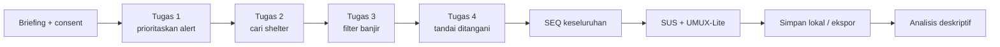

# Disaster Dashboard Usability Study

**Studi Usability Mixed-Methods untuk Dashboard Situasi Bencana**

Prototipe dashboard bencana interaktif (React + TypeScript) dan instrumen studi
usability siap jalan: tugas terukur, pencatatan waktu/percobaan, SEQ, SUS,
UMUX-Lite, ekspor sesi, serta analisis deskriptif.

> **Tidak ada partisipan nyata dalam repositori ini.** Dashboard memakai data
> simulasi fiktif, dan halaman analisis memakai **24 sesi sintetis** yang
> dihasilkan secara deterministik. Angka tersebut hanya menguji perangkat lunak
> dan tidak boleh dilaporkan sebagai temuan usability.

---

## Daftar isi

- [Sorotan](#sorotan)
- [Pertanyaan penelitian](#pertanyaan-penelitian)
- [Fitur prototipe](#fitur-prototipe)
- [Alur studi](#alur-studi)
- [Metrik](#metrik)
- [Menjalankan](#menjalankan)
- [Data DEMO](#data-demo)
- [Struktur](#struktur)
- [Pengujian](#pengujian)
- [Keterbatasan](#keterbatasan)
- [Etika](#etika)
- [Lisensi](#lisensi)

## Sorotan

- Dashboard responsif dengan peta skematik SVG tanpa tile eksternal.
- Empat tugas studi dengan validasi target berbasis state, bukan self-report.
- Timer, hitungan percobaan, dan SEQ per tugas.
- Kuesioner SUS (10 item) dan UMUX-Lite (2 item) dengan skor otomatis.
- Penyimpanan lokal di `localStorage`; tidak ada backend atau pengiriman data.
- Analisis deskriptif: completion rate + Wilson CI, median waktu, SUS/UMUX mean
  dan CI, distribusi skor, rincian per tugas.
- Ekspor sesi JSON/CSV.
- Protokol penelitian lengkap di [`docs/study-protocol.md`](docs/study-protocol.md).
- 27 unit/component test dan production build yang lulus.

## Pertanyaan penelitian

1. Seberapa tinggi completion rate empat tugas inti?
2. Tugas mana yang paling lama dan paling sering diulang?
3. Bagaimana skor SUS, UMUX-Lite, dan SEQ peserta?
4. Elemen desain mana yang perlu diiterasi sebelum studi sumatif?

Studi bersifat **formatif dan eksploratif**; tidak ada klaim kausal atau
perbandingan dengan sistem lain.

## Fitur prototipe

### Dashboard

- KPI peringatan aktif, shelter terbuka, pengungsi, dan muka air.
- Peta skematik dengan penanda tingkat Awas/Siaga/Waspada/Normal (SVG lokal).
- Daftar peringatan dengan filter kategori dan aksi "Tandai ditangani".
- Detail peringatan dan detail shelter.
- Grafik tren hujan dan muka air 18 jam (Recharts).
- Tabel shelter dan ringkasan kecamatan.

Semua nama tempat dan angka adalah simulasi. Peta bukan peta geografis dan
tidak boleh dipakai untuk navigasi.

### Mode studi

- Briefing, kode peserta anonim, peran, dan persetujuan.
- Empat tugas berurutan dengan target yang diperiksa otomatis.
- Timer mulai eksplisit, hitungan percobaan, dan feedback kegagalan.
- SEQ per tugas dan SEQ keseluruhan.
- Kuesioner SUS/UMUX-Lite dan komentar terbuka.
- Ekspor sesi dan penyimpanan lokal.

### Analisis

- Tab **DEMO sintetis** (24 sesi) dan **Sesi lokal**.
- Banner sintetis yang eksplisit.
- Completion rate per tugas dengan Wilson 95% CI.
- Median waktu, rata-rata percobaan, error rate, dan SEQ.
- Rata-rata SUS/UMUX-Lite dengan 95% CI normal-approximation.
- Histogram SUS dan unduhan CSV.

## Alur studi



## Metrik

| Metrik | Definisi |
|---|---|
| Task success | Target state terpenuhi sebelum tugas diakhiri |
| Time on task | Dari "Mulai tugas" sampai target terpenuhi |
| Attempts | Jumlah pemeriksaan, termasuk gagal |
| Error rate | Rata-rata `max(0, attempts − 1)` per tugas |
| Completion CI | Wilson score interval 95% |
| SUS | `Σ skor item × 2,5` (0–100) |
| UMUX-Lite | `((i1−1)+(i2−1))/12 × 100` (0–100) |
| SEQ | Item tunggal 1–7 |

## Menjalankan

Prasyarat: Node.js 20+ (diuji pada Node 24.19.0) dan npm.

```bash
npm install
npm run dev
```

Buka URL yang ditampilkan Vite (biasanya http://localhost:5173).

Build produksi:

```bash
npm run build
npm run preview
```

Uji:

```bash
npm test
```

Hasilkan data sesi sintetis (opsional; aplikasi sudah mengimpor sesi DEMO secara
langsung):

```bash
npm run demo:sessions
```

Perintah ini menulis `public/demo/sessions.json`,
`public/demo/analysis-summary.json`, dan `public/demo/sessions.csv` (gitignored).

## Data DEMO

- Peringatan, shelter, dan tren di `src/data/demoData.ts` sepenuhnya fiktif.
- Sesi sintetis dihasilkan oleh `createDemoSessions()` di
  `src/data/demoSessions.ts` dengan seed deterministik.
- Setiap sesi memiliki `synthetic: true`, ID `DEMO-Sxx`, dan kode `DEMO-Pxx`.
- Sesi lokal dari prototipe memiliki `synthetic: false` dan hanya tersimpan di
  browser pengguna.

Jangan mencampur sesi sintetis dengan data partisipan nyata. Jangan meng-commit
hasil ekspor partisipan.

## Struktur

```text
disaster-dashboard-usability-study/
├── docs/
│   └── study-protocol.md
├── public/demo/               # output DEMO (gitignored)
├── scripts/
│   └── generate-demo-sessions.ts
├── src/
│   ├── components/
│   │   ├── AnalysisPage.tsx
│   │   ├── Dashboard.tsx
│   │   ├── DisasterMap.tsx
│   │   ├── MethodsPage.tsx
│   │   ├── Questionnaire.tsx
│   │   └── TaskPanel.tsx
│   ├── data/
│   │   ├── demoData.ts
│   │   ├── demoSessions.ts
│   │   └── study.ts
│   ├── lib/
│   │   ├── metrics.ts
│   │   ├── storage.ts
│   │   └── useStudy.ts
│   ├── test/setup.ts
│   ├── App.tsx
│   ├── main.tsx
│   ├── styles.css
│   └── types.ts
├── tests/
├── index.html
├── package.json
├── tsconfig*.json
└── vite.config.ts
```

## Pengujian

Status pada mesin pengembangan:

- `npm run build` — **lulus** (Vite 6.4.5; peringatan chunk >500 kB dari Recharts).
- `npm test` — **27 passed** (5 file).

Cakupan:

- formula SUS, UMUX-Lite, mean/median/SD, CI, dan Wilson interval;
- validasi sesi dan ringkasan tugas;
- determinisme sesi sintetis dan label `DEMO`;
- konsistensi target tugas dengan data dashboard;
- render dashboard, pemilihan alert, acknowledge, filter, dan detail shelter;
- alur studi: mulai sesi, keberhasilan target, kegagalan target;
- label data sintetis dan navigasi halaman Metode.

Test tidak menjalankan studi manusia dan tidak mengirim data ke jaringan.

## Keterbatasan

- **Tidak ada data partisipan nyata.** Semua hasil adalah demo perangkat lunak.
- Dashboard bukan sistem operasional dan tidak boleh dipakai untuk evakuasi.
- Data peta/peringatan fiktif; bukan kondisi Bengkulu yang sebenarnya.
- Desain satu kondisi, urutan tetap; tidak bisa memisahkan order effect.
- Terjemahan SUS/UMUX-Lite belum divalidasi psikometrik.
- Analisis hanya deskriptif; tidak ada uji signifikansi atau model campuran.
- Sampel formatif kecil akan menghasilkan interval lebar.
- Prototipe belum diuji aksesibilitas secara formal (WCAG audit, screen reader).
- Belum ada studi komparatif dengan dashboard lain.

## Etika

Studi manusia memerlukan persetujuan etik institusi, informed consent, dan
perlindungan data. Prototipe ini menyimpan data di browser dan menyediakan
ekspor; peneliti bertanggung jawab atas penyimpanan yang aman. Jangan memasukkan
nama, kontak, atau informasi sensitif ke kolom komentar. Lihat
[`docs/study-protocol.md`](docs/study-protocol.md).

## Lisensi

MIT — lihat [`LICENSE`](LICENSE). Instrumen SUS dan UMUX-Lite tetap mengikuti
ketentuan publikasi aslinya; sitasi ada di protokol.
